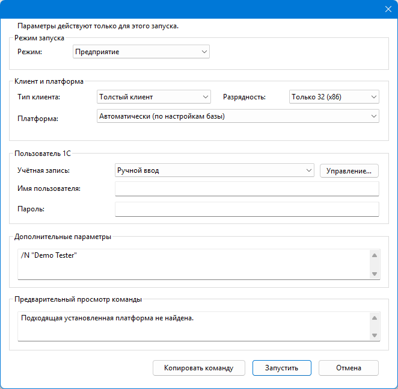
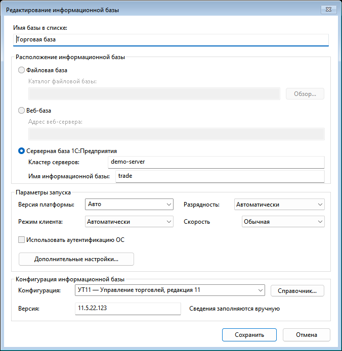
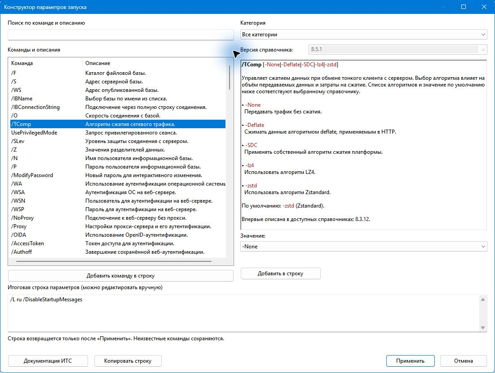
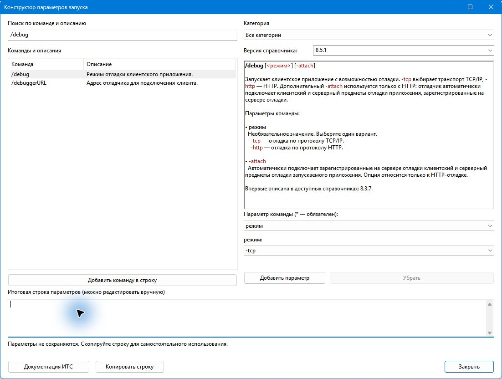
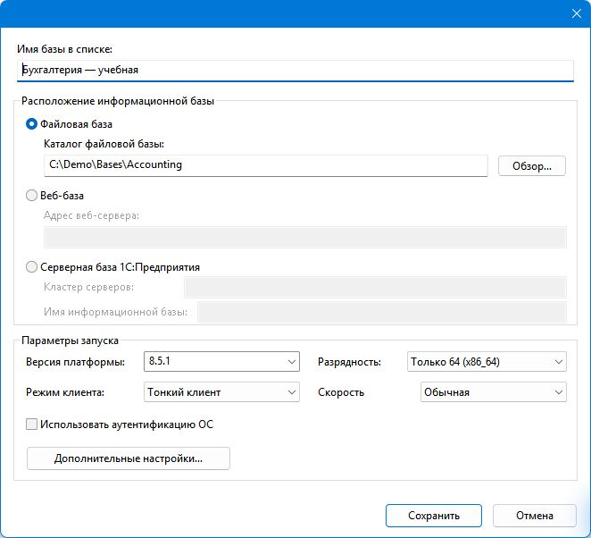
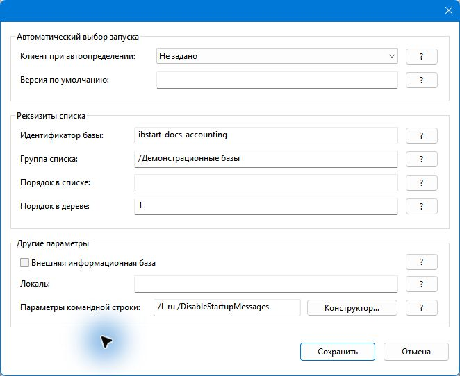
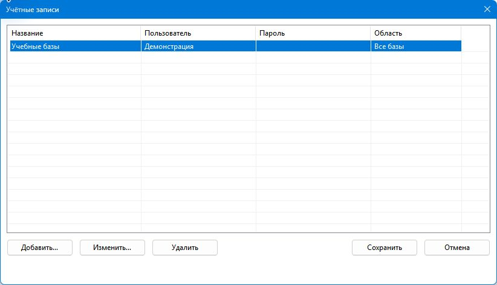
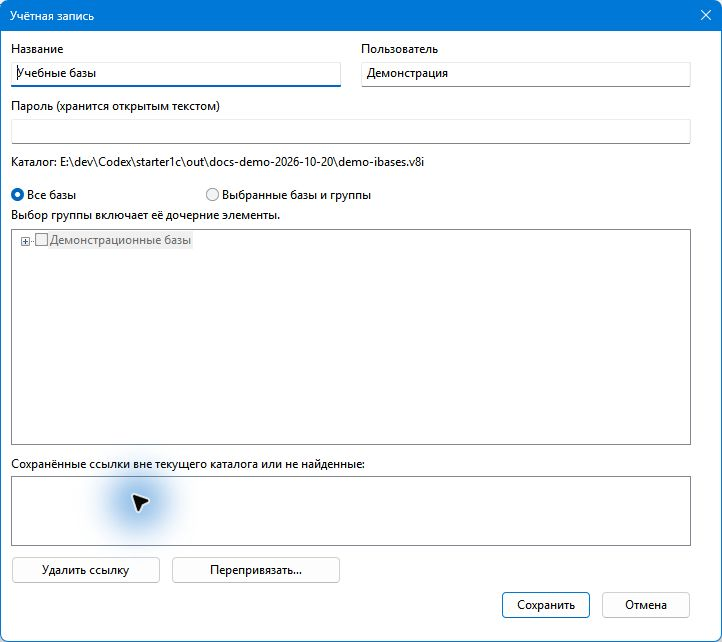
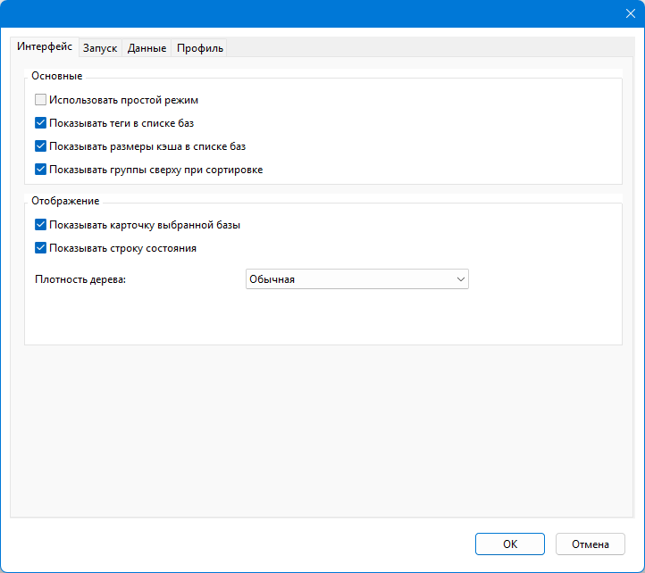
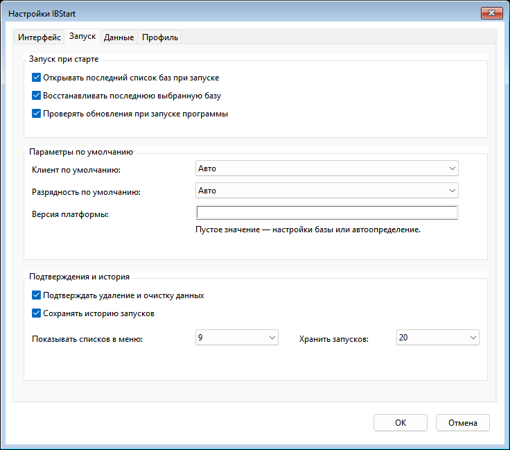

# Возможности

IBStart предназначен для повседневной работы со списками информационных баз 1С:Предприятие без тяжёлых дополнительных компонентов.

## Запуск баз

- запуск **1С:Предприятия** клавишей `F3`;
- запуск **Конфигуратора** клавишей `F4`;
- разовый **Запуск с параметрами…**;
- выбор конкретной установленной платформы;
- выбор типа клиента и разрядности;
- дополнительные параметры командной строки;
- быстрый запуск избранных баз через `Alt+1`…`Alt+9`;
- история недавних запусков.

*Разовый запуск: выбранные параметры действуют только для этого запуска.*

## Конфигурации и версии

- отдельный справочник с именем из метаданных 1С, полным и кратким наименованиями;
- начальный набор шести семейств: Бухгалтерия, ЗУП, УТ11, ERP 2, УНФ 3.0, Розница 3.0;
- выбор конфигурации и ручной ввод версии каждой базы, независимо от версии платформы;
- поиск по конфигурации и версии вместе с существующим поиском и фильтром тегов;
- компактная метка в дереве, полные сведения в карточке и подсказке;
- перенос справочника и связей с экспортом профиля.

Получение сведений из базы и проверка актуальных релизов относятся к следующим этапам.

## Конструктор параметров запуска

С версии **0.8.0** одна форма доступна из поля дополнительных параметров разового запуска,
дополнительных настроек базы и через **Инструменты → Конструктор параметров запуска…**.
При самостоятельном открытии можно собрать и скопировать строку без выбранной базы и запуска 1С.

- поиск по команде, краткому описанию и полному тексту встроенной справки;
- 166 пунктов каталога с пояснениями команд, значений и вложенных параметров;
- 24 справочника: 8.3.6–8.3.27, стабильная 8.5.1 и тестовая 8.5.4;
- поля значений, списки вариантов, выбор файлов и отдельных опций сложных команд;
- обязательные значения отмечены `*`; известные зависимости и конфликты проверяются перед применением;
- изменение и удаление уже добавленных команд, ручное редактирование и копирование итоговой строки;
- переход к официальной документации ИТС для выбранной версии.

*Пример вызова из разового запуска: версия справочника определяется контекстом запуска.*

Подробности и ограничения описаны в [руководстве пользователя](user-guide.md#конструктор-параметров-запуска).
Проверка справочника помогает составить строку; результат выполнения команд зависит от платформы 1С и базы.

*Открытие из меню: версию можно выбрать вручную, строку — скопировать, окно — закрыть без записи.*

## Списки информационных баз

- чтение и сохранение `ibases.v8i`;
- группы и иерархия;
- файловые, серверные и веб-базы;
- добавление, редактирование и удаление записей;
- перемещение между группами;
- резервные копии перед записью;
- сохранение неизвестных полей без потери данных.

*Редактор базы: расположение и параметры запуска.*

*Дополнительные настройки: результат конструктора возвращается в поле параметров командной строки.*

## Поиск и организация

- быстрый поиск по базам;
- избранное;
- теги и настраиваемые цвета;
- фильтрация и сортировка;
- раздел «Недавние»;
- простой компактный режим интерфейса.

## Учётные записи

Именованные записи пользователя и пароля доступны через **Настройки → Учётные записи…**
и в окне разового запуска. Область применения — все базы либо выбранные базы и группы.
Запись группы действует и для вложенных баз. При запуске подходящие записи выбираются с учётом этой области.

Пароли сохраняются открытым текстом в профиле приложения. Порядок настройки и правила
экспорта описаны в [руководстве](user-guide.md#учётные-записи-и-запуск-с-параметрами).

## Платформы 1С

IBStart автоматически ищет установленные клиенты через стандартные каталоги Program Files, реестр Windows и дополнительные каталоги пользователя.

## Кэш

- безопасная очистка известных каталогов кэша;
- фоновый расчёт размера кэша;
- расчёт для одной базы, папки или всего списка;
- сохранение результатов измерения в профиле IBStart.

## Portable mode

IBStart можно использовать как обычное приложение с данными в `%LOCALAPPDATA%\IBStart\` или как portable-приложение с данными в `data\` рядом с `IBStart.exe`.

## Настройки приложения

Параметры интерфейса, запуска, данных и профиля собраны в одном окне с вкладками.

*Вкладка «Интерфейс»: отображение дерева, тегов, размеров кэша и карточки базы.*

На вкладке **Запуск** можно отключить фоновую проверку обновлений IBStart.
При включённой проверке новая версия обозначается пунктом главного меню,
без всплывающего окна. Ручная команда **Справка → Проверить обновления…**
сохраняется независимо от этой настройки.

[Скачать последнюю версию](download.md){ .md-button .md-button--primary }
