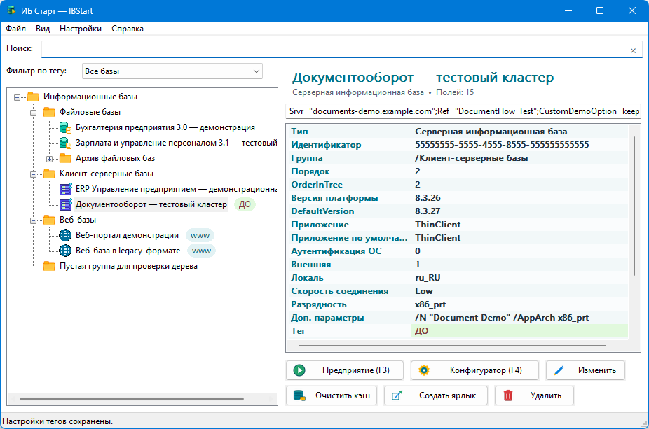

# ИБ Старт — IBStart

## Менеджер запуска 1С для Windows

**IBStart (ИБ Старт)** — лёгкое нативное приложение для просмотра списка информационных баз из `ibases.v8i` и запуска установленных клиентов 1С:Предприятие 8.3/8.5.

[Скачать последнюю версию](https://github.com/ant-m13/ibstart/releases/latest){ .md-button .md-button--primary }
[Руководство](user-guide.md){ .md-button }
[GitHub](https://github.com/ant-m13/ibstart){ .md-button }

## Основные возможности

### Быстрый запуск
Запуск **Предприятия** и **Конфигуратора**, избранные базы, недавние запуски и горячие клавиши.

### Параметры запуска
Разовый запуск с выбором платформы, клиента, разрядности, пользователя и дополнительных параметров.

### Работа со списком баз
Группы, файловые, серверные и веб-базы, поиск, теги, сортировка и безопасное сохранение `ibases.v8i`.

### Кэш 1С
Безопасная очистка известных каталогов кэша и фоновый расчёт размеров для базы, папки или всего списка.

### Portable mode
Работа как обычное приложение или полностью переносимый режим с локальным каталогом данных.

### Проверка обновлений
По явной команде IBStart проверяет последний стабильный GitHub Release и предлагает открыть страницу новой версии.

[Все возможности →](features.md){ .md-button }

## Что нового

История изменений формируется из корневого `CHANGELOG.md`, поэтому сайт и GitHub Release используют один источник данных.

[Посмотреть историю изменений](changelog.md){ .md-button }

## Требования

- Windows 10 или Windows 11, x64;
- установленная 1С:Предприятие 8.3 или 8.5;
- права администратора для обычной работы не требуются;
- подключение к интернету для основной работы не требуется.

!!! info "Независимый проект"
    IBStart распространяется по лицензии MIT и не является официальным продуктом фирмы «1С».
