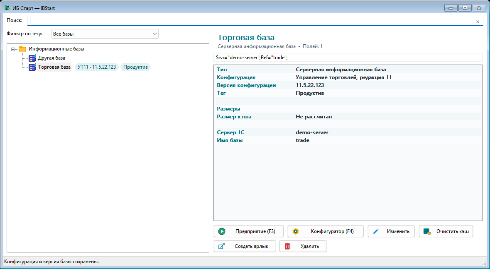
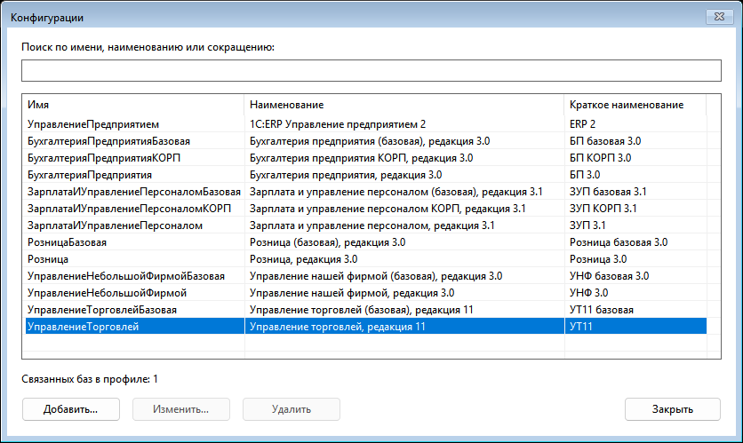
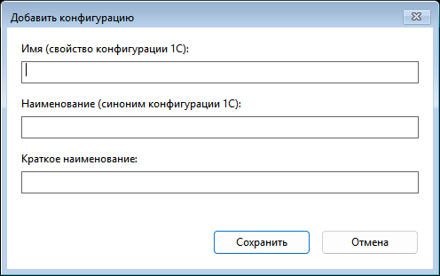
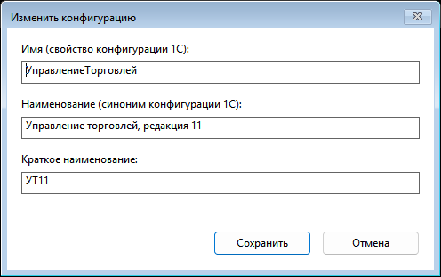

# Краткое руководство пользователя

## Сведения о программе

Команда **Справка → Сайт проекта** и ссылка в окне **Справка → О программе**
открывают [сайт IBStart](https://ant-m13.github.io/ibstart/) с возможностями,
загрузкой и руководствами.

Точная версия установленного IBStart отображается через **Справка → О программе**. Та же версия записана в свойства `IBStart.exe` и совпадает с тегом соответствующего GitHub Release.

По умолчанию IBStart один раз проверяет обновления после показа главного окна. Настройка **Проверять обновления при запуске программы** находится в **Настройки → Параметры приложения… → Запуск**. Если снять галочку, при запуске проверка и сетевой запрос не выполняются. Изменение настройки действует со следующего запуска; переключение режима и повторное открытие уже работающего приложения не запускают новую проверку.

Проверка при запуске выполняется в фоне без всплывающих окон. Если найдена более новая стабильная версия, после **Справка** появляется пункт **Доступно обновление …** с её номером; нажатие открывает страницу этого релиза в браузере. В простом режиме пункт появляется после **Режим**. Он остаётся видимым после открытия страницы и переключения режимов до закрытия приложения либо до успешной проверки, которая больше не находит новую версию. Результат между запусками не сохраняется. При отсутствии обновления, опубликованного релиза или интернета никаких окон не появляется; ошибки записываются в журнал. Автоматических повторных попыток в этом запуске нет.

Независимо от галочки можно выбрать **Справка → Проверить обновления…** в обычном режиме. Эта команда показывает подробный результат и при новой версии предлагает открыть её страницу. При ошибке диалог содержит кнопку **Открыть журнал**, которая открывает текущий файл журнала; если это не удалось, приложение покажет полный путь к файлу. Обе проверки получают только небольшой файл версии `IBStart.version` из последнего стабильного GitHub Release, без обращения к GitHub REST API. Скачивание, замена EXE и установка не выполняются автоматически.

## Конфигурации и версии баз

Откройте **Инструменты → Конфигурации…**. Справочник содержит постоянный идентификатор
каждой записи, **Имя** из свойства конфигурации 1С, **Наименование** из её синонима
и необязательное **Краткое наименование** для метки. Начальный набор включает
Бухгалтерию предприятия 3.0, ЗУП 3.1, УТ11, ERP 2, УНФ 3.0 и Розницу 3.0.
Базовые и КОРП-поставки представлены отдельными записями. Другие конфигурации можно добавить вручную.

Список показан таблицей с колонками **Имя**, **Наименование** и **Краткое наименование**.
Строки разделены сеткой; ширину колонок можно менять, перетаскивая границы заголовков.
Кнопка **Добавить…** открывает небольшое окно с пустыми полями. Для изменения выделите
запись и нажмите **Изменить…** — откроется такое же окно с текущими данными.
В справочнике, открытом из меню «Инструменты», двойной щелчок по строке тоже открывает
изменение. При выборе конфигурации из редактора базы двойной щелчок подтверждает выбор.

Поиск в справочнике учитывает все три текстовых поля. В отдельном окне заполните поля
и нажмите **Сохранить**: запись сразу появится или обновится в таблице и останется выделенной.
**Отмена**, Escape и крестик закрывают окно ввода без сохранения. Отмена редактора базы
не отменяет отдельно сохранённые записи справочника. Без выделенной строки кнопки
**Изменить…**, **Удалить** и **Выбрать** недоступны.
Используемую конфигурацию удалить нельзя: сначала очистите или измените привязки баз,
включая базы из других списков этого профиля. Удалённые предопределённые записи не добавляются
повторно при каждом запуске.

В **Изменить базу** доступны поля **Конфигурация** и **Версия**. При вводе в поле конфигурации
список сокращается по имени, полному или краткому наименованию. Для новой записи откройте
**Справочник…**, сохраните её и нажмите **Выбрать**. Можно оставить конфигурацию неуказанной
или заполнить только версию. Версия вводится вручную, включая собственные обозначения релизов.
Версия платформы в параметрах запуска остаётся независимой.

При смене конфигурации или подключения с неизменённой заполненной версией программа предлагает
очистить её либо сохранить. Переименование базы сохраняет привязку. Изменение только этих
двух полей не перезаписывает `ibases.v8i`. Версии одной конфигурации у разных баз независимы.

Обычная строка поиска баз учитывает имя, полное и краткое наименования конфигурации и версию,
включая частичные совпадения. Поиск сочетается с выбранным тегом или избранным и действует
в основных, избранных и недавних базах. Связанные папки показываются как контекст найденных баз.

В карточке отображаются полное наименование и версия. В дереве метка имеет вид
**УТ11 · 11.5.22.123**; при нехватке места появляется многоточие, полные сведения доступны
в подсказке. Показ меток регулируется через **Вид → Показывать конфигурацию и версию в списке баз**
или вкладку **Интерфейс** параметров приложения, независимо от тегов.
В простом режиме метки скрыты, поиск по конфигурации и версии работает.

Получение имени и версии из базы, проверка актуальных релизов и даты проверок относятся
к следующим этапам. Совпадающие имена разных редакций разрешены; автоматическое сопоставление
по одному имени на этом этапе не выполняется.

## Хранение настроек и данных

**Обычная версия.** Если `IBStart.exe` запущен без файла `IBStart.portable` рядом с ним, общие параметры, история открытых списков, настройка показа тегов и размеров кэша, метаданные каталога и журналы хранятся в `%LOCALAPPDATA%\IBStart\`. Настройки находятся в `settings.json`, а избранное, история запусков, даты запусков, теги, их цвета, версии и привязки конфигураций баз, рассчитанные размеры кэша — в `catalog-state.json`. Сам справочник конфигураций находится в `configurations.json`; порядок записей сохраняется в самом `ibases.v8i`.

**Portable-версия.** Архив `IBStart-<версия>-portable-x64.zip` уже содержит пустой `IBStart.portable`. После распаковки в доступную для записи папку те же файлы и журналы сохраняются в `data\` рядом с `IBStart.exe`, поэтому настройки остаются вместе с этой копией программы. Чтобы включить такой режим для отдельно скачанного EXE, создайте рядом с ним пустой файл `IBStart.portable`.

Общие параметры доступны через **Настройки → Параметры приложения…**. Для компактной работы они разделены по вкладкам **Интерфейс**, **Запуск**, **Данные** и **Профиль**. В окне можно включить простой режим, настроить показ тегов, размеров кэша и порядок групп при сортировке, выбрать открытие последнего списка и восстановление выделения, задать клиент, разрядность и версию платформы по умолчанию, настроить плотность дерева, видимость карточки и строки состояния, а также включить или отключить подтверждения удаления и очистки. Переключатель показа размера кэша в дереве находится на вкладке **Интерфейс**, в разделе **Основные**; для быстрого изменения он также доступен в **Вид → Показывать размеры кэша в списке баз**. В карточке базы размер показывается независимо от этой настройки. Запуск с паролем, токеном или другим секретом отдельного подтверждения не требует. История запусков может быть отключена или ограничена пятью, десятью либо двадцатью базами. Дополнительные каталоги поиска платформ 1С можно добавлять, удалять и менять местами кнопками **Вверх** и **Вниз**; порядок используется при следующем поиске установок. Кнопка **Открыть папку профиля** открывает каталог, где хранятся собственные настройки IBStart. **Экспортировать…** сохраняет `settings.json`, `catalog-state.json` и `configurations.json` в выбранную папку; учётные записи не включаются без отдельного подтверждения. **Импортировать…** заменяет настройки и метаданные выбранным профилем, но при ответе «Нет» на вопрос о секретах сохраняет текущие учётные записи. Здесь же можно открыть редакторы учётных записей и тегов и выбрать, сколько недавно открытых списков показывать в меню. После закрытия окна настроек главная форма снова становится активной без изменения её положения среди окон. Параметры запуска по умолчанию применяются только если в самой базе не заданы `App`, `DefaultApp`, `Version`, `DefaultVersion`, `AppArch` или соответствующий параметр запуска. Профиль хранит до девяти последних списков; уменьшение числа отображаемых элементов не удаляет остальные. Для каждого пункта меню **Файл → Недавно открытые списки** доступна команда **Удалить из списка последних** — она убирает путь только из истории IBStart и не удаляет сам файл `ibases.v8i`.

Если отключено автоматическое открытие последнего списка, это влияет только на запуск приложения: **Обновить список** (`F5`) и изменение путей поиска платформ перечитывают текущий каталог, а не очищают его. При экспорте нельзя выбрать текущую папку профиля, включая путь через `.` или другой регистр; импорт принимается только из полной папки с обоими файлами `settings.json` и `catalog-state.json`, поэтому неполный профиль не изменяет текущие данные.

`ibases.v8i` в папку `data` не копируется: приложение продолжает работать с выбранным исходным списком баз. Portable mode также не переносит кэш и настройки самой платформы 1С, которыми платформа управляет в каталогах пользователя Windows.

## Длинные пути Windows

IBStart использует Unicode и Windows-поддержку extended-length paths для пути к `ibases.v8i`, каталогу файловой базы, профилю portable и каталогам журналов. Диалоги открытия списка и выбора каталога используют современный системный интерфейс, поэтому поле `MAX_PATH` в 260 символов не является ограничением самого IBStart.

Остаётся системный предел Windows: приложение принимает путь длиной менее `32767` UTF-16-символов (то есть консервативно не более `32766` символов с учётом завершающего нуля). Для длинных путей также должна быть разрешена политика Windows **Enable Win32 long paths** (`LongPathsEnabled`); на корпоративном компьютере её может включать администратор. Отдельные старые версии платформы 1С и сторонние инструменты могут иметь собственные ограничения.

В обычных полях используйте полный путь в стандартной записи Windows. При ручном редактировании `settings.json` и `ibases.v8i` приложение сохраняет и обрабатывает префиксы `\\?\` и `\\?\UNC\`, если конкретная операция Windows и используемая версия 1С их принимают. Если путь превышает допустимую длину или Windows отклоняет его из-за системной политики, IBStart показывает причину и сам путь; сохранение не выполняется молча.

Полные схемы `settings.json`, `catalog-state.json`, `ibases.v8i`, назначение каждого параметра и правила безопасного ручного изменения приведены в [справочнике конфигурации](configuration.md).
Структура и поля файла описаны в [спецификации формата `ibases.v8i`](ibases-format.md),
а полный реестр параметров и команд 1С для будущей поддержки и обратной совместимости —
в [спецификации запуска](launch-parameters.md). Связь двух моделей описана в
[интеграционной спецификации](ibases-launch-spec.md); правила работы с материалами 1С:ИТС —
в [политике лицензирования](1c-license-compliance.md).

## Выбор списка

После старта в нижней строке отображаются путь к активному списку, число баз в активном каталоге и число обнаруженных платформ 1С. Чтобы переключиться на другой список, выберите **Файл → Открыть список баз**, **Открыть стандартный список 1С** или один из пунктов **Недавно открытые списки**. При первом сохранении IBStart создаёт резервную копию рядом с исходным файлом; стандартный стартер 1С увидит изменения после обновления своего списка.

## Базы и группы

Окно **Добавление информационной базы** и **Редактирование информационной базы** открываются относительно главного окна, а не в углу рабочего стола. В них используется тот же масштабируемый `Segoe UI` с ClearType, что и в основном окне.

В редакторе задаются имя в списке и тип расположения: каталог файловой базы, адрес веб-сервера или кластер и имя серверной базы. Для файловой базы кнопка **Обзор…** выбирает каталог; при добавлении и редактировании каталог должен содержать обычный файл `1Cv8.1CD`. Это проверка существующей базы, а не создание новой. Если локальный каталог отсутствует, недоступен или не содержит этот файл, сохранение блокируется. Для UNC-пути действует та же строгая политика: при временной недоступности сетевого ресурса IBStart предупреждает о проблеме и не сохраняет изменения до восстановления доступа. Группы допускают любую вложенность, а удаление секции не удаляет файлы базы.

Кнопка **Дополнительные настройки…** открывает отдельное окно со служебными полями формата `ibases.v8i`: `DefaultApp`, `DefaultVersion`, `ID`, `Folder`, `OrderInList`, `OrderInTree`, `External`, `Locale` и `AdditionalParameters`. Возле каждого поля есть кнопка **?** с кратким объяснением. `ID` и `Folder` показываются только для справки: идентификатор должен оставаться уникальным, а расположение в группе меняется перетаскиванием или командами перемещения. `OrderInTree` учитывается при построении дерева; при перемещении IBStart синхронно обновляет `OrderInList` и `OrderInTree`.

Для защиты профиля от аномально больших файлов список `ibases.v8i` ограничен 16 МиБ, а `settings.json` и `catalog-state.json` — 4 МиБ каждый. При превышении лимита IBStart не выделяет буфер под весь файл и сообщает о превышении допустимого размера; fingerprint этих файлов рассчитывается потоково.

Ниже находятся параметры запуска из `ibases.v8i`: версия платформы, разрядность, режим клиента, приложение по умолчанию, аутентификация ОС, флаг внешней базы, локаль, скорость соединения и дополнительные параметры. Разрядность имеет варианты «Только 32 (`x86`)», «Только 64 (`x86_64`)», «Приоритет 32 (`x86_prt`)» и «Приоритет 64 (`x86_64_prt`)»; значение сохраняется в `AppArch`. При запуске IBStart учитывает это поле. Непустое неизвестное значение `AppArch` блокирует запуск с диагностикой и не перезаписывается автоматически. Если в `AdditionalParameters` задан валидный `/AppArch`, он имеет приоритет над корректным `AppArch`, как и в стандартном стартере 1С; невалидное значение самого `AppArch`, а также невалидный или повторный `/AppArch` блокирует запуск. В поле «Версия платформы» можно указать как полную версию, так и её начало — например, `8.3.27` сопоставится с установленной `8.3.27.1688`.

Версия платформы, разрядность, тонкий клиент и дополнительные параметры учитываются при запуске из IBStart; остальные поля сохраняются совместимо со стандартным стартером 1С. Неизвестные части исходной строки `Connect` не удаляются при смене адреса или пути. При сохранении известные фрагменты заменяются на своих исходных позициях, поэтому неизвестные фрагменты сохраняют и взаимный порядок, и положение относительно них. Если исходная строка использует legacy-вариант с прямым URL первым фрагментом или пользователь меняет семейство подключения, новый типизированный набор занимает позицию первого прежнего typed-фрагмента, а остальные неизвестные фрагменты сохраняются в исходном порядке.

Перетаскивание элемента на группу меняет его `Folder`, а новый порядок фиксируется одновременно в `OrderInList` и `OrderInTree`.

Щёлкните базу или группу правой кнопкой мыши, чтобы открыть контекстное меню. Для базы доступны запуск Предприятия и Конфигуратора, избранное, изменение, очистка кэша, создание ярлыка, открытие папки файловой базы в проводнике, перемещение вверх/вниз и удаление записи. Для группы доступны изменение, перемещение, удаление и добавление новых баз или вложенной группы непосредственно внутрь неё. В разделе «Недавние» хранится не более 20 уникальных баз: повторный запуск обновляет время и переносит ту же базу в начало без дубликата. Рядом с именем базы отображается относительное время последнего запуска: например, «только что», «5 минут назад» или «2 дня назад»; оно обновляется раз в минуту. Для базы внутри ветки «Недавние» команда **Удалить из недавних** удаляет только историю её запусков: запись в основном `ibases.v8i`, избранное, теги и саму базу не затрагиваются. Команда «Очистить недавние базы…» удаляет только всю историю запусков, не затрагивая сами базы и избранное; она также доступна через **Вид → Очистить недавние базы…**. Щелчок правой кнопкой по пустому месту позволяет добавить элемент в корень и обновить список. После **Обновить список** или `F5` выбранная база или группа остаётся активной, если запись всё ещё есть в файле; для базы из «Недавних» или «Избранного» сохраняется и эта ветка. Если база перестала входить в виртуальный раздел, но есть в обычном каталоге, выделение переносится на ту же базу в каталоге, а не на соседнюю запись.

Названия команд в нём расположены слева, а сочетания клавиш — отдельной приглушённой колонкой справа: они не сливаются с текстом и остаются читаемыми при выделении пункта. Те же комбинации действуют, когда меню закрыто; при наведении на основную кнопку показывается её сочетание.

| Команда | Сочетание |
| --- | --- |
| Предприятие / Конфигуратор | `F3` / `F4` |
| Изменить | `F2` |
| Добавить или убрать из избранного | `Ctrl+Alt+I` |
| Запустить избранную базу в слоте 1–9 | `Alt+1` … `Alt+9` |
| Очистить недавние базы | **Вид → Очистить недавние базы…** |
| Очистить кэш / Создать ярлык | `Ctrl+Shift+Del` / `Ctrl+Shift+S` |
| Пересчитать размеры кэша | **Вид → Пересчитать размеры кэша всех баз** или контекстное меню базы/группы |
| Копировать значение параметра | `Ctrl+C` в таблице сведений |
| Открыть папку файловой базы | `Ctrl+Shift+O` |
| Переместить вверх / вниз | `Ctrl+Shift+Up` / `Ctrl+Shift+Down` |
| Удалить | `Alt+Shift+Del` |
| Добавить информационную базу / группу | `Ctrl+Alt+F` / `Ctrl+Alt+G` |
| Обновить список | `F5` |
| Открыть список баз | `Ctrl+O` |
| Переключить простой режим | `Ctrl+Alt+M` |
| Перейти к поиску | `Ctrl+F` |
| Проверить обновления | **Справка → Проверить обновления…** |
| О программе | `F1` |

Пересчёт размера кэша запускается из **Вид → Пересчитать размеры кэша всех баз**, из контекстного меню базы или из контекстного меню группы. Для группы выбирается вся её вложенная ветка, а для корня — весь текущий каталог, включая базы, скрытые фильтром. Операция выполняется в фоне последовательно, показывает ход и не требует подтверждения; на время расчёта команды запуска, редактирования и очистки блокируются. В простом режиме новые команды расчёта и переключатель их отображения скрыты.

Справа имя и тип выбранного элемента выводятся отдельным заголовком, а строка подключения выбранной базы (`File=…`, `Srvr=…;Ref=…` или веб-адрес) показана отдельным копируемым полем без дополнительной подписи. Щёлкните по строке, чтобы сразу выделить её, и нажмите `Ctrl+C`. Остальные поля `ibases.v8i` выводятся в двухколоночной карточке с понятными русскими названиями. Исходные ключи и значения при этом не изменяются.

Поле **Поиск** фильтрует дерево без учёта регистра по имени, реквизитам базы и её тегам: серверу, строке подключения и другим пользовательским полям списка. Структурный путь группы (`Folder`) и технические поля порядка (`OrderInList`, `OrderInTree`) в обычном поиске не участвуют. Запрос `кд` находит имена с `КД`, а `cluster-01` — базы с таким сервером 1С. Каждый совпавший фрагмент имени выделяется светло-зелёным фоном и тёмно-зелёным текстом; совпадение в цветной метке тега выделяется жирным. Если обычный показ меток отключён, найденная по тегу метка всё равно кратко выводится рядом с подходящей базой. Родительские группы остаются в дереве только как путь к найденной базе и автоматически раскрываются, чтобы результат был виден. Справа в поле всегда отображается кнопка `×` **Очистить поиск**. При пустом поле кнопка неактивна, а после ввода запроса становится доступной; нажатие очищает запрос и возвращает состояние групп до начала поиска.

Теги хранятся в `catalog-state.json`, привязаны к `ID` базы и не меняют `ibases.v8i`. Все команды для них собраны в подменю **Теги** контекстного меню базы: **Управление тегами…** открывает форму назначения, а ниже можно сразу присвоить один из доступных тегов, создать новый тег или открыть общую настройку. Такая же команда доступна в основном меню **Вид** как **Управление тегами выбранной базы…**. Форма назначения заменяет строку «через запятую»: отметьте нужные существующие теги флажками или введите новый и нажмите **Добавить и отметить**. Через **Вид → Настроить теги…** открывается единая форма создания, переименования и удаления тегов; для фона и текста доступны кнопки выбора из палитры, а готовая метка отображается в живом предпросмотре. Переименование и удаление сразу применяются ко всем базам с этим тегом.

Цветные метки тегов показываются рядом с названиями баз в дереве и отдельными строками в карточке. Если метки не помещаются в строку, после последних поместившихся выводится компактная метка **…**; наведите указатель на базу, чтобы увидеть в подсказке полный список её тегов. Их можно скрыть через **Вид → Показывать теги в списке баз**; сами теги и фильтрация при этом остаются доступными. Отдельное поле **Фильтр по тегу** оставляет в дереве все базы, избранные или базы с конкретным тегом. Отдельный виртуальный раздел **Избранное** выводится в самом верху дерева, перед **Недавними** и обычным каталогом.

В контекстном меню корня списка или группы доступны команды сортировки её прямых потомков по возрастанию и убыванию имени. При включённой настройке **Папки всегда сверху при сортировке** группы размещаются перед базами; в любом случае выбранный порядок сохраняется в `OrderInList` и `OrderInTree`. Отдельного глобального режима, индивидуальных профилей сортировки папок или сортировки по времени запуска в текущем интерфейсе нет. В контекстном меню базы и группы команда **Переместить в папку…** открывает дерево групп для выбора назначения. При перетаскивании название записи следует за курсором: наведите его на группу, чтобы перенести запись внутрь, на верхнюю или нижнюю часть другой записи — чтобы вставить перед ней или после неё, либо на свободное место дерева — чтобы перенести в корень списка.

Дополнительные сведения о базе выводятся в той же правой карточке, без отдельного окна и отделены от параметров подключения. У файловой базы это каталог, полный путь к `1Cv8.1CD`, его размер и дата изменения; сведения читаются только с локального диска. Для UNC-пути или подключённого сетевого диска IBStart показывает путь, но не запрашивает сетевой файл, чтобы выбор базы не зависал при недоступном сервере. У клиент-серверной базы показаны сервер 1С и имя базы из `Srvr`/`Ref`. Размер и прочие сведения, требующие подключения к SQL Server, приложение не запрашивает.

Значок записи в дереве показывает тип подключения: зелёная база с документом — файловая база (`File=`), фиолетовая стойка с сетевыми узлами — серверная база, синий глобус — веб-база (`http://` или `https://`). Жёлтая папка обозначает группу. Основные кнопки имеют пиктограммы, но их подписи не обрезаются: в обычном режиме окно не даёт уменьшить ширину ниже размера, необходимого для правой панели.

Для читаемости на обычных и HiDPI-экранах кнопки используют `Segoe UI Semibold`, а поиск, дерево и таблица свойств — обычный `Segoe UI`; оба шрифта создаются с ClearType и масштабируются вместе с окном.

## Запуск

Выберите базу и используйте **F3** для Предприятия или **F4** для Конфигуратора. IBStart ищет установленный клиент самостоятельно; при одинаковой версии «Авто» выбирает x64 раньше x86. Для обычной базы при отсутствии нужной версии запуск отменяется с сообщением.

Для веб-подключения, распознанного как `http://`/`https://`, команда «Предприятие» сначала пытается запустить тонкий клиент (`1cv8c.exe`). Если в `Version` или `DefaultVersion` задана версия, сначала выбирается тонкий клиент этой версии; если подходящей установки нет, выполняется повторный выбор самой новой совместимой установки. При отсутствии версии сразу выбирается самая новая установка. Учитываются ограничения `AppArch` и `/AppArch`, а также отдельная установка «1С:Предприятие — Тонкий клиент», которую IBStart находит автоматически. Если после всех попыток нет совместимой платформы, IBStart сначала повторно проверяет строку `Connect` и параметры запуска; только для корректной web-конфигурации её проверенный URL, в том числе URL 1cfresh, открывается в браузере. «Конфигуратор» для веб-базы недоступен. «Создать ярлык» сохраняет на Рабочий стол ярлык на IBStart с идентификатором базы, но без пароля.

## Учётные записи и запуск с параметрами

В обычном режиме откройте **Настройки → Учётные записи…**. Справочник позволяет добавлять, изменять и удалять именованные записи с пользователем 1С, паролем и областью применения. Название и пользователь обязательны; названия уникальны без учёта регистра, одинаковые логины разрешены. Пароль может быть пустым и сохраняется точно как введён, включая пробелы. Пользователь и пароль отображаются и хранятся в `settings.json` открытым текстом.

Область **Все базы** делает запись доступной во всех списках. Для **выбранных баз и групп** отметьте элементы дерева текущего списка. Выбор группы означает правило для всех её вложенных баз: новые базы включаются автоматически, перемещённые наружу перестают подходить, если не выбраны отдельно. Отметки дочерних элементов независимы и нужны только для явных привязок. Можно объединять несколько групп и отдельных баз.

Привязка учитывает полный путь `ibases.v8i` и ID элемента. У элементов без ID (в том числе многих групп) используется имя; при переименовании через IBStart такая привязка обновляется. После внешнего переименования элемента без ID её нужно исправить вручную. Отсутствующие элементы и привязки к другим спискам сохраняются и отображаются отдельно. Если файл списка перенесён, можно перепривязать выбранную ссылку к текущему списку; совпадение имени файла само по себе ничего не переносит.

В контекстном меню базы выберите **Запуск с параметрами…**. Список **Учётная запись** содержит подходящие записи: сначала назначенные непосредственно базе, затем её группам, затем общие. При открытии выбран **Ручной ввод**. Выбор записи заполняет оба поля; пустой пароль очищает предыдущее значение. Ручная правка действует для текущего запуска и не меняет справочник; возврат к ручному вводу очищает оба поля. **Управление…** открывает тот же справочник из окна запуска.

Изменения справочника сохраняются отдельно от запуска: отмена запуска не отменяет уже сохранённые настройки. Само подставление не изменяет `ibases.v8i`. Обычные F3/F4 и ярлыки не выбирают учётную запись автоматически. При дублировании пользователя или пароля отдельными полями и `/N` или `/P` в дополнительных параметрах приложение сообщает о конфликте. Пустой пароль не добавляет `/P` в команду. Предварительный просмотр и журналы сохраняют существующее скрытие секретов; явное копирование команды содержит полные значения.

## Конструктор параметров запуска

Конструктор доступен с версии **0.8.0**. Снимки ниже сделаны на этой версии;
названия баз, серверов и учётных записей в примерах демонстрационные.

В конструкторе кнопка **Добавить команду в строку** вставляет только имя выбранной
команды. Если все её параметры необязательны, можно оставить команду без них,
например `/RegServer`. Если значение обязательно, заполните его в поле справа:
проверка строки не позволит применить незавершённую команду. Повторно добавить
уже имеющуюся команду этой кнопкой нельзя.

Для команд без аргументов, например `/ClearCache` и `/UnregServer`, поле значения
скрыто. После добавления доступно действие **Удалить из строки**. Историческая
`/DisplayAllFunctions` предусмотрена в профилях 8.3.12–8.3.16; в более новых
профилях выбирайте `/TechnicalSpecialistMode`.

**Конструктор…** рядом с дополнительными параметрами открывает одну и ту же форму из окна **Запуск с параметрами…** и из **Изменить базу → Дополнительные настройки…**. Конструктор получает текущий текст поля, включая ручные правки. В списке видны **Команда** и **Описание**; поиск работает по обоим столбцам, а категории сокращают список. Выбранная команда показывает синтаксис, пояснение и известные ограничения.

Для самостоятельной работы выберите **Инструменты → Конструктор параметров запуска…** в главном меню обычного режима. База может быть не выбрана и список баз может быть пустым. Форма открывается с пустой строкой и справочником старшей установленной платформы; версию можно изменить. Если установок нет, используется стабильный профиль 8.5.1. Проверка выполняется по мере ввода. **Копировать строку** помещает текущий текст в буфер обмена для использования в другом приложении. **Закрыть** завершает работу без сохранения параметров; этот режим не изменяет базу, настройки, историю и не запускает 1С. Кнопка копирования доступна и при вызове из полей.

В самостоятельном конструкторе доступны `/F`, `/S`, `/WS`, `/IBName` и `/IBConnectionString`. При вызове из дополнительных параметров базы они заблокированы с пояснением: подключение задаётся в настройках базы. Ручной ввод этих команд тоже не позволяет применить строку дополнительных параметров; ошибочно добавленную команду можно удалить.

Для обычных поддержанных команд доступны поле значения или список вариантов; для `/Out` — выбор файла и флажок дописывания. **Добавить в строку** вставляет команду. У уже добавленной команды со значением доступны **Изменить в строке** и отдельное **Удалить из строки**. Для флага без значения, например `/DisableStartupMessages`, основная кнопка сразу предлагает **Удалить из строки**; после удаления — добавить его снова. Кнопки учитывают и ручные изменения итоговой строки. Неоднозначные повторения и нестандартные конструкции нужно править вручную: конструктор сохраняет неизвестные части. Ввод `/C` с пробелами остаётся одним аргументом. Пустая итоговая строка очищает исходное поле после применения.

У команд с вложенными параметрами появляется список **Параметр команды**. Выберите нужный параметр, задайте его значение или вариант и нажмите **Добавить параметр**. Для флага без значения поле ввода скрывается. Следующий параметр добавляется к той же команде, сохраняя остальные; **Изменить параметр** меняет выбранный фрагмент, **Убрать** удаляет только его. Основной аргумент называется по синтаксису команды: например, **каталог загрузки \***. Если аргументов несколько, их имена перечисляются вместе; значения с пробелами в таком составном поле заключайте в кавычки. Одиночные значения структурированных полей конструктор заключает в кавычки сам. При выборе параметра справка прокручивается к его описанию, оставляя видимым заголовок параметра.

Команда выделена жирным, имена параметров и значений — цветом. Текст справки можно выделять и копировать.
Для `/debug` поле режима предлагает `-tcp` или `-http`; необязательный `-attach` выбирается отдельно и применяется только с HTTP.

Например, `/ConfigurationRepositoryCreate` имеет семь вложенных параметров: `-AllowConfigurationChanges`, `-ChangesAllowedRule`, `-ChangesNotRecommendedRule`, `-NoBind`, `-MinPasswordLenght`, `-CheckPasswordComplexity`, `-Extension`. Их можно сочетать. Для двух правил поддержки доступны `ObjectNotEditable`, `ObjectIsEditableSupportEnabled` и `ObjectNotSupported`; группа разрешения изменений проверяется совместно. У `/SetPredefinedDataUpdate` три альтернативных режима: `-Auto`, `-UpdateAutomatically`, `-DoNotUpdateAutomatically`. В режиме `-Auto`, используемом по умолчанию, главный узел обновляет предопределённые элементы автоматически, периферийный — не обновляет. Противоречивое сочетание режимов диагностируется.

В правой части формы показан синтаксис выбранной версии. Каждый вложенный параметр, его назначение и значения перечислений выводятся отдельными строками. Набор параметров меняется вместе с версией справочника. Неоднозначные повторения одной команды или одной опции сохраняются для ручной правки; конструктор не заменяет их догадкой и не удаляет неизвестные параметры.

Список «Параметр команды» следует порядку из документации. Звёздочка `*` означает, что параметр обязателен для текущего набора опций; условия также указаны в описании. Например, у `/Proxy` всегда обязательны `-PSrv` и `-PPort`. После добавления `-PPwd` обязательным становится `-PUser`. Необязательность самого параметра и необязательность его значения учитываются отдельно.

Название основного аргумента берётся из синтаксиса выбранной версии без угловых скобок. У `/LoadConfigFromFiles` это `каталог загрузки *`. В поле одного аргумента вводите путь или значение целиком: кавычки для пробелов и экранирование добавляются автоматически. Например, `C:\work files\dump.cf` для `/DumpCfg` превращается в `/DumpCfg "C:\work files\dump.cf"`. Уже заключённое в кавычки значение также принимается без удвоения кавычек.

Для нескольких основных аргументов их имена перечисляются через точку с запятой. Эти значения вводятся как отдельные аргументы командной строки; каждый путь с пробелами нужно заключить в собственные кавычки. Например, у `/DumpExternalDataProcessorOrReportToFiles` корневой файл и внешняя обработка остаются двумя значениями, а не объединяются в одну строку. Ручное редактирование итоговой строки сохраняет исходный текст и не расставляет кавычки автоматически.

У `/LoadConfigFromFiles` пояснение отдельно описывает полную и частичную загрузку. В профилях 8.3.7–8.3.27 и 8.5.1 при полной загрузке формат распознаётся автоматически, а для частичной загрузки через `-files` или `-listFile` требуется явный `-Format`: его обязательность отмечается и проверяется. Расширение и основную конфигурацию нельзя загружать друг вместо друга. В справочнике тестовой 8.5.4 вводный текст ещё упоминает `-Format`, но синтаксис и перечень опций его не содержат; форма сообщает об этом расхождении и не переносит опцию из стабильного профиля.

Параметры можно выбирать в любой последовательности: при добавлении, изменении или удалении через поля конструктор располагает известные опции в порядке выбранного справочника. Например, результат для прокси: `/Proxy -PSrv http://proxy -PPort 30 -PUser user -PPwd password`. Само открытие формы и ручной ввод не переставляют исходную строку. Пропуски обязательных параметров, основных аргументов и несовместимые варианты отображаются в сообщении проверки. Вернуть ошибочную строку через «Применить» нельзя; в самостоятельном конструкторе сообщение остаётся доступным для проверки.

У отдельных команд порядок влияет на смысл: при совместном указании `-files` и `-listFile` для `/LoadConfigFromFiles` действует первый из них. Такой фрагмент редактируется вручную, чтобы сохранить выбранный приоритет. По текстовому пояснению документации эти параметры, `-Format` и `-partial` не считаются безусловно обязательными, несмотря на отсутствие скобок в заголовке команды. Вместо каталога загрузки можно указать `-Archive`; одновременно их указывать нельзя.

Для подключения Конфигуратора к хранилищу доступны отдельные поля значений команд `/ConfigurationRepositoryF` (адрес), `/ConfigurationRepositoryN` (пользователь) и `/ConfigurationRepositoryP` (пароль). Адрес передаётся Конфигуратору при запуске; он не является командой создания хранилища или привязки конфигурации. Пароль виден в редактируемой строке и сохранённых параметрах, но маскируется в журнале и предпросмотре команды. Команды с одним основным аргументом, например `/EmailAuth <email>`, также имеют поле ввода. Доступность редактора и вариантов определяется выбранной версией; специальные справочные разделы используют ручное редактирование строки.

**Применить** возвращает строку только в вызвавшее поле. Для разового запуска она действует до закрытия окна запуска. В настройках базы её дополнительно нужно сохранить в редакторе базы; отмена любого внешнего редактора отменяет его несохранённые изменения. **Отмена**, Escape и крестик конструктора не меняют исходное поле. Конструктор сам не запускает платформу и не записывает список баз.

Версия справочника в разовом запуске берётся из выбранной установки платформы и фиксируется, если установка определена. В настройках базы справочник начинается с указанной версии, и её можно менять для просмотра; это не меняет версию запуска в свойствах базы. При «Авто» или пустой версии выбирается старшая установленная платформа. Для префикса вроде `8.3` выбирается старшая установка этой ветки; при отсутствии подходящей установки префикс сохраняется. Профили: 8.3.6–8.3.27, стабильная 8.5.1 и тестовая 8.5.4. Профилей 8.5.2 и 8.5.3 нет. У неизвестной версии доступность не считается подтверждённой: она не заменяется соседним профилем. Версию можно вводить вручную, начиная с `8` или `8.3`, без принудительной подстановки первого пункта. Изменение версии не удаляет уже введённые аргументы.

Команда, не найденная в выбранном справочнике, остаётся видимой с соответствующей пометкой, первой версией её появления в доступных справочниках и списком версий, где она описана. Это документальная граница, а не доказательство первого выпуска команды. Варианты значений зависят от профиля; например, `/Theme` использует `-Dark` и `-Light`. Пакетные команды с описанными вложенными параметрами доступны через их отдельный выбор. Само выполнение пакетных операций, web/mobile, создание базы, агент и OLE требуют соответствующего сценария запуска. **Документация ИТС** открывает официальный раздел выбранной версии; для полного текста может требоваться вход. Подробности — в [матрице версий](launch-parameter-versions.md).

Для всех 166 пунктов каталога форма показывает встроенные пояснения: назначение, смысл значений и вложенных опций. Тексты написаны для программы своими словами по официальной документации и доступны сразу, без файлов справки и доступа к ИТС. Пояснения учитывают выбранную версию, включая единицы измерения, значения по умолчанию, приоритеты и ограничения; одинаковые имена опций в разных командах могут иметь разный смысл. Поиск работает и по подробному тексту справки. Допустимые перечисления меняются вместе с версией: например, старые профили `/TComp` не получают новые алгоритмы и их значение по умолчанию. Проверка отражает документированные опции; известные зависимости и конфликты проверяются в конструкторе, остальные условия выполнения сложных пакетных операций проверяет платформа. Повторяющиеся сообщения об успешной сверке и стабильности ветки из описания убраны; тестовая 8.5.4 помечена в списке версий.

Дополнительные параметры остаются в `AdditionalParameters` и передаются совместимо с аргументами клиента. Пароль, токен и другие секреты можно сохранить через `/P`, `/WSP`, `/AccessToken`, `password`, `token`, `secret`, credentials в URL или в строке `/IBConnection`; они будут видны в файле списка и интерфейсе. Запуск с обнаруженным секретом не блокируется и не требует отдельного подтверждения — это осознанное решение политики IBStart. В журналах и автоматически создаваемых диагностических сообщениях значения маскируются, включая весь userinfo URL, а полный операнд `/IBConnection` скрывается целиком. Значение можно скопировать из таблицы сведений явной командой пользователя; буфер обмена не считается защищённым хранилищем.

В таблице сведений выделите параметр и нажмите `Ctrl+C`, чтобы скопировать его значение. Контекстное меню таблицы также позволяет скопировать параметр вместе со значением.

## Параметры и кэш

Размер кэша считается только по безопасному allowlist-каталогам: `%APPDATA%\1C\1Cv8`, `%LOCALAPPDATA%\1C\1Cv8` и `%LOCALAPPDATA%\IBStart\cache`. Для базы используется её непустой `ID`, а при его отсутствии — имя; строка `Connect` для построения пути не используется. Каталог файловой базы, произвольные пути из списка и каталоги `licenses`, `license` и `lic` в расчёт не входят. Симлинки и точки повторного входа в дерево не обходятся.

После расчёта полный результат сохраняется в `catalog-state.json` по идентификатору базы. В дереве он показывается нейтральной меткой **Кэш …**, а в карточке базы всегда есть раздел **Размеры**. Полный расчёт отображает точный объём, включая `0 Б` для пустого кэша; если часть файлов недоступна, перед объёмом ставится `≈`, а в карточке указывается дата и состояние неполного расчёта. Пока база ещё не рассчитывалась, карточка показывает **Размер кэша: Не рассчитан**. Переключатель **Показывать размеры кэша в списке баз** доступен в **Настройки → Параметры приложения… → Интерфейс → Основные** и как быстрый пункт **Вид**; он влияет только на метки в дереве и не скрывает раздел карточки.

При очистке кэша сначала выполняется предварительное сканирование для подтверждения. Отказ оставляет старый сохранённый результат; после подтверждения прежняя метрика считается недействительной. По завершении очистки IBStart всегда повторно сканирует разрешённые каталоги и сохраняет фактический остаток: нулевой, точный или приблизительный. Отмена, ошибка до повторного сканирования или невозможность сохранить результат не подменяются ложным нулём.

«Очистить кэш» сначала показывает точный список известных cache-папок, размер каждой из них и общий примерный объём для очистки. Проверяются каталоги `%APPDATA%\1C\1Cv8\<ID>` и `%LOCALAPPDATA%\1C\1Cv8\<ID>` (где `<ID>` — идентификатор базы из поля `ID`, иначе её имя), а также собственный каталог `%LOCALAPPDATA%\IBStart\cache\<ID>`. Если обнаружен работающий процесс `1cv8.exe` или `1cv8c.exe`, IBStart предупреждает, что занятые файлы могут остаться и очистка может быть неполной; процесс не завершается автоматически, а пользователь может продолжить операцию. Очистка выполняется по всем разрешённым каталогам, поэтому ошибка одного каталога не прерывает попытку очистить остальные. После операции проверьте результат в сообщении и журнале: освобождённое место отображается в Б, КБ, МБ или ГБ. Если часть файлов осталась, закройте процессы 1С и повторите очистку. Каталог файловой базы не является допустимой целью этой команды.

## Простой режим

Меню **Вид → Простой режим** оставляет компактный рабочий экран: поиск, дерево баз, строку подключения выбранной базы и кнопки **Предприятие** и **Конфигуратор**. Строка подключения копируется так же, как в обычном режиме. Скрываются карточка выбранной базы, теги, фильтр по тегам и сортировка. Остальные основные действия с выбранной базой остаются в контекстном меню дерева: **Изменить**, **Удалить**, **Переместить в папку…**, **Переместить вверх** и **Переместить вниз**. В простом режиме минимальная ширина окна уменьшена, поэтому дерево можно сделать заметно уже без пустой области справа. В верхнем меню остаётся только пункт **Режим → Выйти из простого режима** (также работает `Ctrl+Alt+M`); после выхода обычные элементы и команды возвращаются. При следующем запуске приложение восстанавливает выбранную перед закрытием базу или группу, если она всё ещё есть в активном списке. Это настройка удобства для пользователя, а не механизм защиты от действий в файловой системе.
